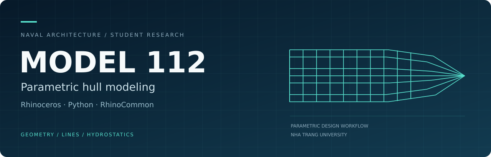

  

  <strong>Hull geometry · Lines plans · Hydrostatics · Parametric studies</strong> 
  <a href="README.vi.md">Tiếng Việt</a> · <a href="#four-working-modes">Features</a> · <a href="#research-and-verification">Verification</a> · <a href="#project-status">Project status</a>

## Overview

**MODEL 112** is a student research project that uses **Python and RhinoCommon** to automate the geometric modeling of hard-chine ship hulls in Rhinoceros.

The project connects hull parameters, characteristic curves, surface generation, lines plans and basic hydrostatic calculations in one workflow. It was developed at **Nha Trang University** under project **SV2025-13-112**, from **September 2025 to September 2026**.

## Four working modes

| Mode | Purpose | Main outputs |
| --- | --- | --- |
| **01 · Hull modeling** | Define hull geometry through design parameters and characteristic curves | Keel, stem, chines, sheer, transom, stations and hull surfaces |
| **02 · Lines & offsets** | Derive drawing data from the generated hull | 3D sections, 2D lines plans and offset tables |
| **03 · Hydrostatics** | Evaluate the submerged hull at selected drafts | Basic hydrostatic quantities, including displacement volume and longitudinal center of buoyancy |
| **04 · Parametric studies** | Explore bow rake angle α and deadrise angle β | Hull variants and comparisons of geometry and hydrostatic characteristics |

## Research and verification

- **Hydrostatics:** compared with Orca3D at **13 drafts** for the reference hull.
- **Parametric study:** generated a **5 × 5 matrix of 25 hull variants** to examine changes in α and β.
- **Reported deployment:** a plugin, launcher and supporting components for **Rhinoceros 6, 7 and 8**.

These are results for the configurations documented in the research report. The hydrostatic comparison identified a larger discrepancy at **T = 1.50 m** that requires further investigation; it does not establish accuracy for arbitrary hulls.

## Technical foundation

| Area | Tools and methods |
| --- | --- |
| Development | Python, RhinoCommon API |
| User interface | Eto.Forms |
| Geometry | Parametric curves, NURBS, BRep, Loft and Sweep2 |
| Engineering outputs | Hull surfaces, sections, lines plans, offset tables and basic hydrostatics |
| Verification | Geometric checks and comparison with Orca3D |

## Project status

This repository currently contains the **project overview and original portfolio graphics**. The plugin source code, launcher and installer have **not been published here**, so this is a portfolio overview rather than an installable release.

**Next research directions:** planing-hull parameterization, broader geometric checks and further validation. Resistance prediction, AI surrogate models and multi-objective optimization are future research directions.

## Team

- **Phạm Huỳnh Đức** — Project lead
- **Võ Lê Khang** — Research team member
- **ThS. Trần Đình Tứ** — Academic supervisor
- **Faculty of Marine Engineering, School of Engineering and Technology, Nha Trang University**

## Contact

[Phạm Huỳnh Đức on LinkedIn](https://www.linkedin.com/in/%C4%91%E1%BB%A9c-ph%E1%BA%A1m-816787308)

Project basis: “Nghiên cứu giải thuật và viết plugin tự động vẽ mô hình hình học tàu gãy góc,” student research report, SV2025-13-112, September 2026; Chapters 3–4.
