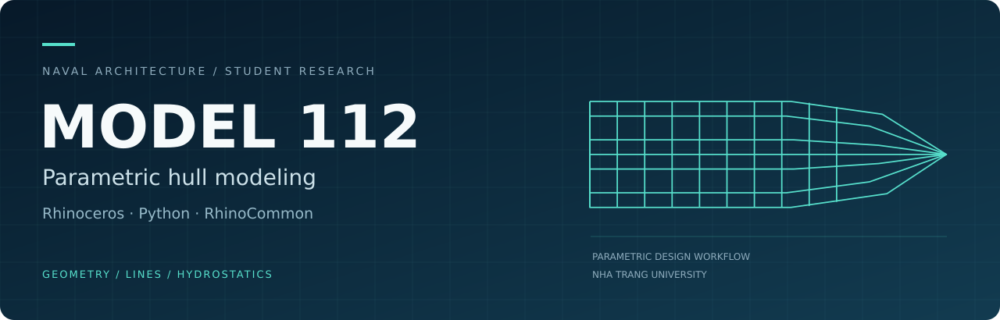

  

<a href="README.md">English</a> · <strong>Hình học vỏ tàu · Đường hình · Thủy tĩnh · Khảo sát tham số</strong>

## Giới thiệu

**MODEL 112** là sản phẩm nghiên cứu khoa học sinh viên ứng dụng **Python và RhinoCommon** để tự động tạo mô hình hình học tàu gãy góc trên Rhinoceros.

Chương trình liên kết bộ tham số thiết kế, các đường đặc trưng, bề mặt vỏ tàu, đường hình và tính toán thủy tĩnh cơ bản trong cùng một quy trình. Đề tài được thực hiện tại **Trường Đại học Nha Trang**, mã số **SV2025-13-112**, thời gian **9/2025–9/2026**.

## Bốn chế độ làm việc

| Chế độ | Nội dung | Kết quả chính |
| --- | --- | --- |
| **Mode 1 — Tạo vỏ tàu** | Điều khiển hình học qua tham số và đường đặc trưng | Keel, stem, chine, sheer, transom, sườn và bề mặt vỏ |
| **Mode 2 — Đường hình và bảng tọa độ** | Khai thác dữ liệu từ mô hình đã tạo | Đường hình 3D, bản vẽ 2D và bảng tọa độ |
| **Mode 3 — Thủy tĩnh** | Tính toán phần chìm tại các mớn nước được chọn | Các đại lượng thủy tĩnh cơ bản, trong đó có thể tích chiếm nước V và tọa độ tâm nổi dọc LCB |
| **Mode 4 — Khảo sát tham số** | Thay đổi góc nghiêng sống mũi α và góc vát đáy β | Các phương án vỏ tàu và kết quả so sánh hình học, thủy tĩnh |

## Kết quả và kiểm chứng

- Đối chiếu kết quả thủy tĩnh với **Orca3D tại 13 mớn nước** trên mẫu tham chiếu.
- Tạo **25 phương án** trong ma trận khảo sát **5 × 5** của hai góc α và β.
- Báo cáo ghi nhận bộ plugin, bộ khởi chạy và thành phần hỗ trợ **Rhinoceros 6, 7 và 8**.

Các kết quả trên thuộc những cấu hình được trình bày trong báo cáo. Phép đối chiếu thủy tĩnh còn ghi nhận sai lệch lớn hơn tại **T = 1,50 m**, cần tiếp tục kiểm tra. Kết quả này chưa xác nhận độ chính xác cho mọi hình dạng thân tàu.

## Công cụ và phương pháp

**Python · RhinoCommon · Eto.Forms · NURBS · BRep · Loft · Sweep2**

## Trạng thái kho lưu trữ

Kho này hiện cung cấp **phần giới thiệu dự án và đồ họa hồ sơ được thiết kế riêng**. Mã nguồn plugin, bộ khởi chạy và bộ cài **chưa được công bố tại đây**.

Hướng nghiên cứu tiếp theo gồm tham số hóa planing hull, mở rộng kiểm tra hình học và bổ sung kiểm chứng. Dự đoán sức cản, mô hình thay thế AI và tối ưu đa mục tiêu thuộc hướng phát triển tương lai.

## Nhóm thực hiện

- **Phạm Huỳnh Đức** — Chủ nhiệm đề tài
- **Võ Lê Khang** — Thành viên
- **ThS. Trần Đình Tứ** — Giảng viên hướng dẫn
- **Khoa Kỹ thuật Biển, Trường Kỹ thuật và Công nghệ, Trường Đại học Nha Trang**

[Liên hệ qua LinkedIn](https://www.linkedin.com/in/%C4%91%E1%BB%A9c-ph%E1%BA%A1m-816787308)

*Căn cứ nội dung: Báo cáo tổng kết “Nghiên cứu giải thuật và viết plugin tự động vẽ mô hình hình học tàu gãy góc”, mã SV2025-13-112, tháng 9/2026, Chương 3–4.*
